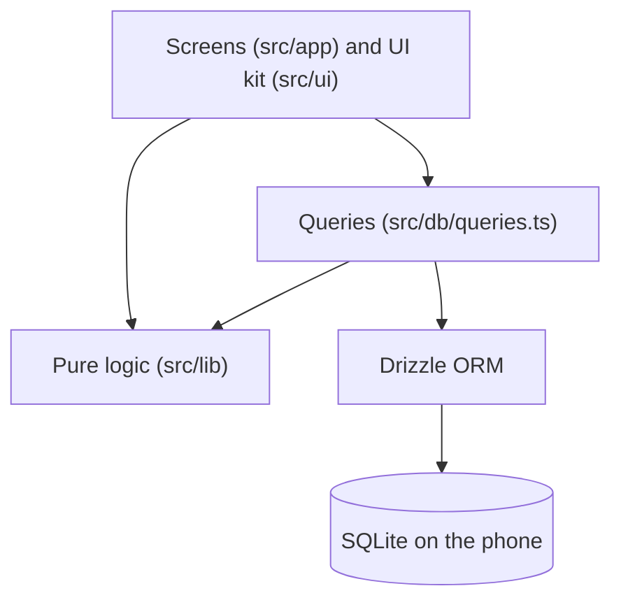
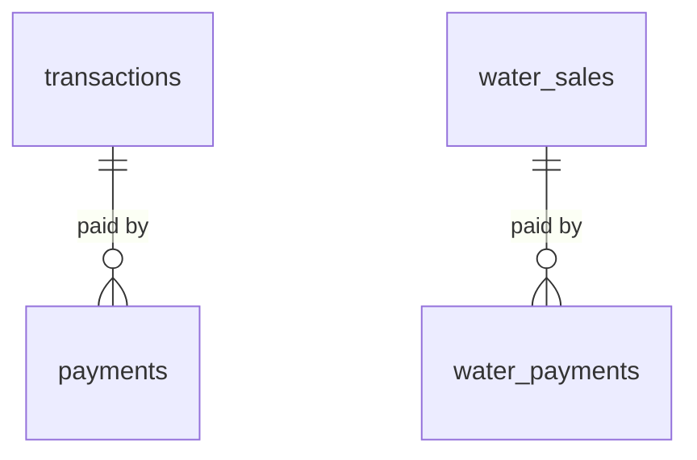

# Architecture

## Overview

A single-user, offline-first mobile app. Everything runs on the phone: there is no server, no account and no network request. Data lives in a SQLite database inside the app's private storage.



| Layer                 | Folder                         | Responsibility                                                                                                                                    |
| --------------------- | ------------------------------ | ------------------------------------------------------------------------------------------------------------------------------------------------- |
| Screens               | `src/app`                      | Routing and what the user sees. Reads and writes through the query functions; no SQL here.                                                        |
| UI kit                | `src/ui`                       | Theme (light and dark palettes) and reusable components: `Screen`, `Card`, `Button`, `Field`, `Segmented`, `Row`, `Chip`, `InfoPanel` and others. |
| Feature components    | `src/components`               | Components tied to this app's data: name suggestions, payment history.                                                                            |
| Queries               | `src/db/queries.ts`            | The only place that talks to the database. Returns plain objects.                                                                                 |
| Schema and migrations | `src/db/schema.ts`, `drizzle/` | Table definitions, and the generated SQL that creates and upgrades them.                                                                          |
| Pure logic            | `src/lib`                      | Calculations with no database and no UI: fees, summary, utang balances, cash check, CSV export, dates, money.                                     |

The rule that keeps this maintainable: **calculations live in `src/lib` as pure functions that take plain data and return plain data.** Anything that touches money can be tested without a phone.

## Navigation

expo-router, file-based.

```
src/app/
  _layout.tsx          Root: runs migrations, seeds defaults, applies the saved theme
  (tabs)/
    _layout.tsx        Bottom tabs + header buttons (theme toggle, settings)
    index.tsx          Today
    utang.tsx          Utang
    water.tsx          Water
    cash-check.tsx     Cash check
  new.tsx              GCash / load entry (create and edit)
  water-sale.tsx       Water sale (create and edit)
  water-delivery.tsx   Water delivery (create and edit)
  utang-customer.tsx   One customer's balance and payments
  settings.tsx         Settings
  fee-table.tsx        Editable GCash fee table
  backup.tsx           Backup, export and restore
  deleted.tsx          Deleted entries, with Restore
```

The four tabs are the daily screens. Everything else is pushed on top of them. The same screen is used to **create and edit** an entry: it receives an `id` parameter in edit mode and loads the saved row.

## Data model



| Table              | Purpose                                                                                                                                    |
| ------------------ | ------------------------------------------------------------------------------------------------------------------------------------------ |
| `fee_tiers`        | The GCash fee table (`min_amount`, `max_amount`, `fee`, in centavos)                                                                       |
| `settings`         | Key/value settings (see BUSINESS_RULES, section 9)                                                                                         |
| `transactions`     | Cash-in, cash-out and load entries: type, amount, fee, cost (load), name or number, paid flag, fee-deducted flag, timestamps, `deleted_at` |
| `payments`         | Money received on an unpaid transaction: amount, **method** (cash or gcash), date                                                          |
| `water_sales`      | Gallons, price per gallon, **cost per gallon at the time**, name, paid flag, `deleted_at`                                                  |
| `water_payments`   | Money received on an unpaid water sale (same shape as `payments`)                                                                          |
| `water_deliveries` | Gallons delivered and cost per gallon, note, `deleted_at`                                                                                  |
| `day_closings`     | Cash-check counts: opening or closing, actual cash and GCash, and what was expected at the time                                            |

Conventions:

- **Money is integer centavos.** Never floating point.
- **Timestamps are milliseconds since the epoch**, in UTC; "today" is computed in the phone's local time.
- **Deleted means hidden.** Entries have a `deleted_at` column and every query that lists or totals entries filters on it. Nothing is erased, so a mistake can be undone.
- **Derived values are never stored:** balances, stock, totals and expected cash are computed each time from the rows above.
- Payments are kept in two tables (one for transactions, one for water sales) so each can have a real foreign key.

## Database lifecycle

1. `drizzle-kit generate` reads `src/db/schema.ts` and writes SQL into `drizzle/`.
2. Babel's inline-import plugin and a Metro `sql` source extension bundle those `.sql` files into the app (`babel.config.js`, `metro.config.js`).
3. On every start, `useMigrations` in `src/app/_layout.tsx` applies any migration the phone does not have yet. The migration history is stored in the database itself, so a restored backup upgrades itself on the next start.
4. `seedIfEmpty` loads the default fee table and settings the first time only.

## Theming

`src/ui/theme.ts` holds a light and a dark palette. The exported `colors` object is **shared and mutable**: `applyScheme()` copies the active palette into it, so every file that imports `colors` sees the new values the next time it renders. This avoids passing a theme through every component.

- The root layout reads the saved mode (`light`, `dark` or `system`), asks Android to use it (`Appearance.setColorScheme`, so alerts and the keyboard match), and re-renders when `useColorScheme()` changes.
- Screens are rebuilt on a mode change with a `key` on the layout, because their styles are computed from `colors` at render time. The Stack keeps its own place; the Tabs navigator is rebuilt and told which tab to start on.
- Entry-type colors (`typeMeta`) are getters so they follow the palette.
- In dark mode the accent colors are lighter, so text on filled buttons becomes dark (`onFill`).

## Backup and restore

All in `src/app/backup.tsx`.

- **Backup:** `serializeAsync()` returns a consistent copy of the whole database as bytes. It is written to a file in the cache folder and handed to the system share sheet. The time is saved as `last_backup_at`.
- **CSV export:** `src/lib/export.ts` builds one CSV with every table's rows (deleted ones included, marked), sorted by date. Names and numbers are escaped so a spreadsheet does not treat them as formulas.
- **Restore:** the file is picked with the system picker (`File.pickFileAsync`), its header is checked for the SQLite signature, it is opened as a temporary in-memory database (`deserializeDatabaseAsync`) and checked for this app's tables, and after confirmation `backupDatabaseAsync` copies it **over the live database**. The app then asks to be closed and reopened so migrations and screens start from the restored data.

## Design decisions

| Decision                                                | Why                                                                                                                                       |
| ------------------------------------------------------- | ----------------------------------------------------------------------------------------------------------------------------------------- |
| **Offline-first, no backend in v1**                     | The shop does not always have a signal, and a notebook never loses it. It also keeps a family business's records off third-party servers. |
| **Integer centavos**                                    | Floating-point money drifts.                                                                                                              |
| **Soft delete and calculated totals**                   | Mistakes are normal in a shop; they must be fixable without corrupting totals.                                                            |
| **Fee table as data, not code**                         | The shop owner can change fees without a new release.                                                                                     |
| **Cost snapshots on sales and loads**                   | Changing a supplier price later must not rewrite past profit.                                                                             |
| **A cash check that resets its baseline at each count** | A difference should appear once, not follow her around every day.                                                                         |
| **Pure functions in `src/lib`**                         | The risky logic (money) can be tested without a phone.                                                                                    |
| **Soft errors over hard blocks**                        | A sale above the recorded stock, or a count with a difference, warns instead of refusing, because the records may be what is wrong.       |
| **No integration with GCash or GlobeOne**               | Neither offers a public way to read a personal wallet's transactions. See the [roadmap](ROADMAP.md).                                      |
